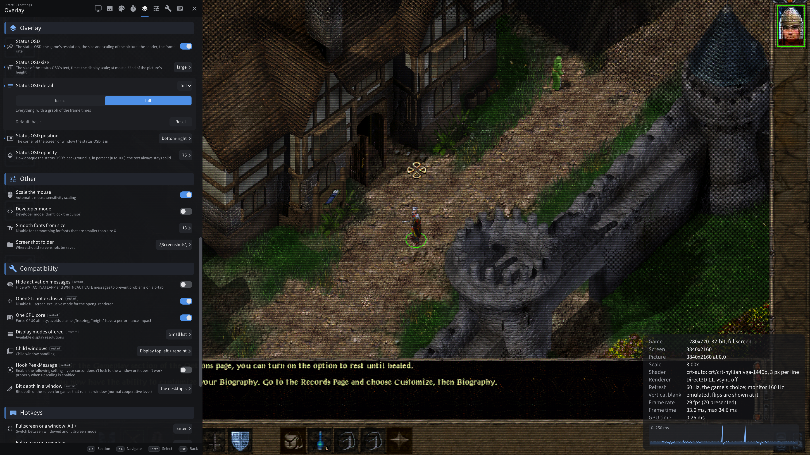

# DirectCRT

DirectCRT is a `ddraw.dll` replacement for 2D DirectDraw games from the Windows 98
and XP era. Those games render at 640x480, 800x600 etc., which looks blurry or
tiny on today's screens. DirectCRT gives them
[DOSBox Staging](https://www.dosbox-staging.org/)'s picture: its scaling, its
colour adjustments and its CRT shading (`crt-auto`), which makes them look as
they did on a period CRT monitor.

[](docs/images/baldurs-gate.webp?raw=true)
*Baldur's Gate (BioWare, 1998) at 640x480 on a 4K screen, with the settings
and status OSDs open. Open the image at full size to see the shading.
Baldur's Gate © 1998 BioWare Corp.; see [Licence](#licence).*

It's a fork of [cnc-ddraw](https://github.com/FunkyFr3sh/cnc-ddraw) by
FunkyFr3sh. The DirectDraw implementation, the Windows API hooks and the
compatibility settings come from cnc-ddraw, and so do the fixes it applies to
a few games by itself (StarCraft, Battle.net, Age of Empires II, Claw, ...).
cnc-ddraw's built-in profiles for 285 games, and the game-specific hacks they
turned on, aren't part of DirectCRT: a setting a game needs goes in its own
`directcrt.ini`. The renderers and the display settings are new.

## Features

- **CRT shading from DOSBox Staging.** `shader=crt-auto`, the default, uses
  `crt-auto`'s VGA monitor: its shaders, its choice of shader for the
  screen's size, its picture size and its colours, with the same result as
  DOSBox. `sharp`, `nearest` and `bilinear` are the other shaders.
- **Scaling as in DOSBox Staging:** aspect ratio correction, integer scaling
  and a viewport of any size, with every shader. The picture can be moved
  too, like a CRT's position controls, with the arrow keys or the mouse in
  the settings OSD.
- **Colour adjustments as in DOSBox Staging:** CRT colour profiles,
  brightness, contrast, gamma, colour temperature and gain, saturation and
  black level, with every shader, and wide gamut colour spaces (Display P3,
  DCI-P3, Adobe RGB, Rec. 2020) for monitors that show them.
- **Fullscreen or a window.** `display=auto` follows the game. Fullscreen is
  at the desktop resolution, so the shading has room to work; `original`
  switches the monitor to the game's resolution instead, for real CRTs and
  external scalers. A window can be small, medium, large, a size of your own
  or unscaled, and games that run in their own window are scaled the same
  way.
- **Settings while the game runs.** The settings OSD (Alt+F12) has every
  setting with its help. Most changes apply at once, and so do edits to
  `directcrt.ini`, which is created next to `ddraw.dll` the first time a
  game starts.
- **Status OSD** (Alt+F11): the game's mode, the picture's size and scale,
  the shader and renderer, the frame rate and a graph of the frame times.
- **An emulated refresh rate.** The game's flips and waits for the vertical
  blank follow a display at the rate it asks for (`emulated_refresh`),
  whatever the monitor runs at.
- **Direct3D 11 and OpenGL 3.3**, fallback to Direct3D 11 on WARP
- **Screenshots** (Print Screen): the game's own picture and what's on
  screen, as PNG files.

## Status

Early development. [docs/development-plan.md](docs/development-plan.md)
covers the goals, the decisions and the phases.

DirectCRT runs on Windows 10 and 11. Wine and Proton are untested so far.

## Using it

1. Copy `ddraw.dll` into the game's folder, next to its `.exe`.
2. Start the game.

To try it on Wine or Proton, set `ddraw` to "native, builtin" in `winecfg`
(Libraries), or start the game with `WINEDLLOVERRIDES="ddraw=n,b"`.

DirectCRT only handles DirectDraw: Direct3D games aren't supported. A game
with several renderers needs its DirectDraw or "software" renderer selected.

A compatibility setting a game needs goes in its own `directcrt.ini`, next to
its `ddraw.dll`. cnc-ddraw's
[wiki](https://github.com/FunkyFr3sh/cnc-ddraw/wiki) lists the settings many
games need (the section is `[directcrt]` here, not `[ddraw]` or one named after
the game).

### Hotkeys

| Keys | Action |
|---|---|
| Alt+Enter | Switch between a window and fullscreen |
| Ctrl+Tab, or Right Alt+Right Ctrl | Release the mouse |
| Alt+Page Down | Maximise the window |
| Alt+F11 | Show or hide the status OSD |
| Alt+F12 | Open or close the settings OSD |
| Print Screen | Save a screenshot |

## Building

You need Visual Studio 2026 with "Desktop development with C++". Open
`DirectCRT.sln`, or build from a Developer Command Prompt:

```
msbuild DirectCRT.sln -m -p:Configuration=Release -p:Platform=x86
```

Everything goes to `bin\<configuration>\`. There are four configurations:

- **Release**: the normal build.
- **DebugLog**: optimised, and writes a detailed log, for bug reports.
- **DebugLogMini**: like DebugLog, with a shorter log.
- **Debug**: unoptimised.

The solution also builds [ddtest](tools/ddtest/README.md), a DirectDraw test
pattern program for checking scaling, colour depth and presentation. Its
regression test, `tools\ddtest\regress.ps1`, checks DirectDraw's blits and
GDI text across interface versions, presentation methods and bit depths; it
takes over the screen for about 40 seconds.

Unit tests: `tests\run_tests.cmd` from a Developer Command Prompt.

A fresh default `directcrt.ini`, after a change to the settings:
`powershell -NoProfile -ExecutionPolicy Bypass -File tools\default-ini.ps1`
replaces the one in `bin\Release\` (`-Dll` and `-Out` pick another DLL or
file). It loads the DLL without running a game.

## Licence

DirectCRT as a whole is licensed under the GNU General Public License, version 2
or (at your option) any later version; see [LICENSE](LICENSE). It includes
code ported from DOSBox Staging, which is GPL-2.0-or-later.

The code that comes from cnc-ddraw is also available under its original MIT
licence, in [LICENSE-cnc-ddraw.txt](LICENSE-cnc-ddraw.txt). Bundled third-party
code keeps its own licence:

- Microsoft Detours: MIT ([src/detours/LICENSE.md](src/detours/LICENSE.md))
- LodePNG: zlib (`src/lodepng.c`)
- Khronos OpenGL headers: MIT-style (`inc/glcorearb.h`, `inc/wglext.h`, `inc/KHR/`)
- DOSBox Staging's shaders in `third_party/dosbox-staging/`: MIT, except
  `sharp.glsl` (GPL-2.0-or-later); see its README
- Dear ImGui, for the OSDs: MIT (`third_party/imgui/LICENSE.txt`)
- Source Sans 3, the OSDs' font: SIL Open Font License 1.1
  (`third_party/fonts/source-sans-3/LICENSE.md`)
- Material Icons, the OSDs' icons: Apache License 2.0
  (`third_party/fonts/material-icons/LICENSE`)

The screenshot in `docs/images/` isn't covered by these licences. It shows
Baldur's Gate, © 1998 BioWare Corp.; Baldur's Gate is a trademark of Wizards
of the Coast LLC. It's here only to show what DirectCRT does; DirectCRT isn't
affiliated with or endorsed by either.
